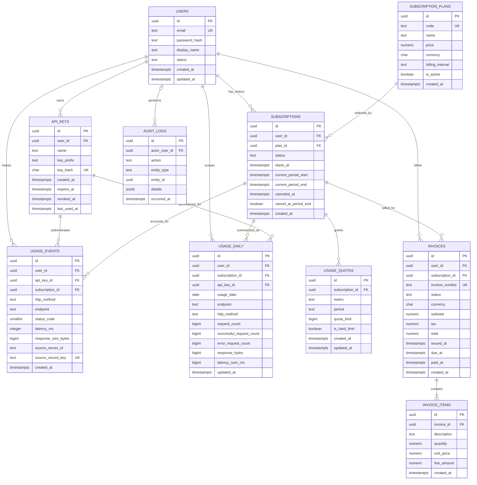

# MeterFlow Entity-Relationship Diagram

The diagram shows the ten relational tables planned for PostgreSQL. All IDs
are UUIDs unless they are a date, counter, or business value. Crow's-foot
notation: `||` means exactly one, `o|` zero or one, and `o{` zero or many.

`source_record_key` is a nullable idempotency key for an imported source row;
it contains a stable row identity, not a raw IP, API key, or user credential.
`USAGE_DAILY` is derived aggregation data, not a replacement for the event
ledger.
